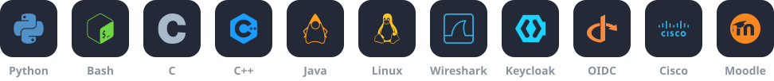

  

  

 

### About me

Fourth-year **Networks & Telecommunications** engineering student at **INSAT**, specializing in cybersecurity.
I build detection in SIEM labs, wire up identity with Keycloak and Active Directory, and take binaries apart in Ghidra.

 

### Tech stack

  

  Security Onion &nbsp;·&nbsp; Suricata &nbsp;·&nbsp; Zeek &nbsp;·&nbsp; Active Directory &nbsp;·&nbsp; LDAP/LDAPS &nbsp;·&nbsp; Ghidra &nbsp;·&nbsp; IDA

 

### Experience

- **Identity & Access Management Intern** · Adactim, Tunis &nbsp;`Aug 2026`\
  Integrated multiple Active Directory domains with Keycloak (SSO, OIDC, RBAC) for a secure multi-tenant Moodle platform.

- **Cyber Security Analyst Intern** · Adactim, Tunis &nbsp;`Jul – Aug 2025`\
  Deployed Security Onion SIEM in a multi-OS lab, simulated SQL & command injection attacks, and tuned detection rules.

 

### Certifications

  
  
  
  

 

  

