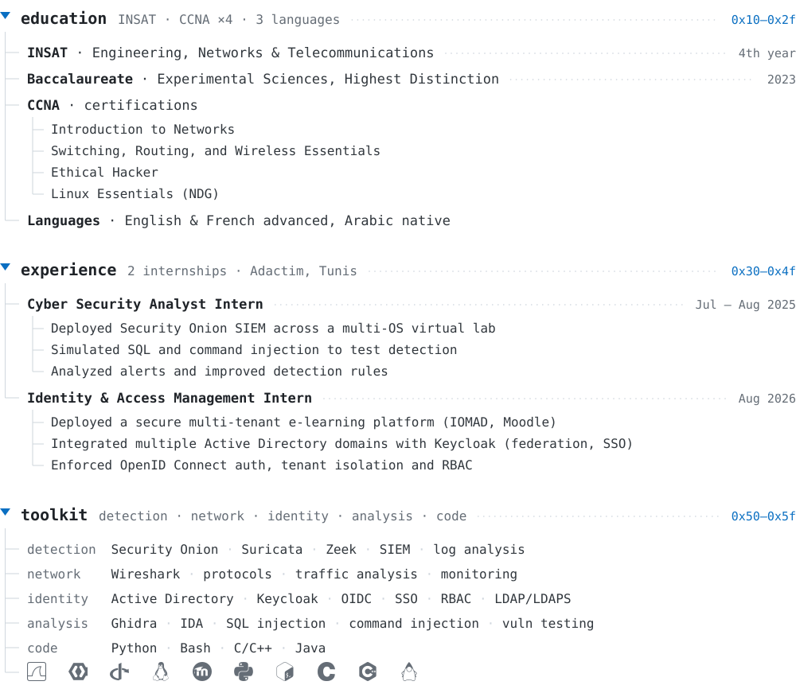
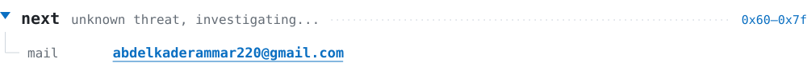

<picture>
  <source media="(prefers-color-scheme: dark)" srcset="assets/hero-dark.svg">
  
</picture>

  

<picture>
  <source media="(prefers-color-scheme: dark)" srcset="assets/packet-dark.svg">
  
</picture>

  

<a href="mailto:abdelkaderammar220@gmail.com">
  <picture>
    <source media="(prefers-color-scheme: dark)" srcset="assets/next-dark.svg">
    
  </picture>
</a>
